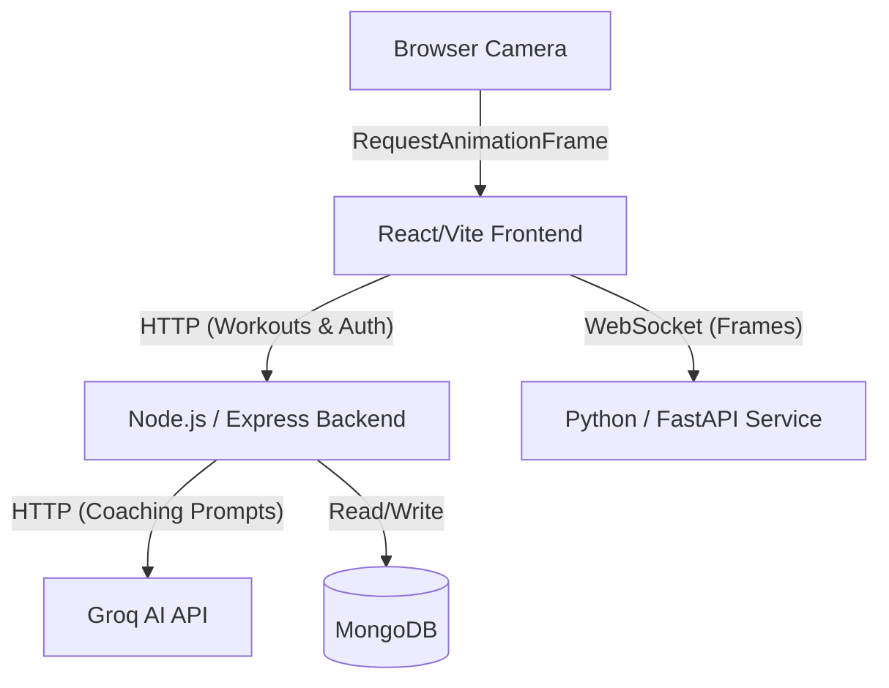

# GymSense AI

GymSense AI is an intelligent fitness tracking application that utilizes on-device computer vision to monitor exercise form, count repetitions deterministically, and provide generative AI coaching feedback—all while prioritizing privacy (no camera frames are ever saved or transmitted externally).

## Architecture



## Features
- **Deterministic Rep Counting**: Rule-based state machines calculate joint angles via MediaPipe to track Squats, Push-ups, and Deadlifts perfectly.
- **Privacy-First AI Coaching**: Sends only lightweight workout metadata (e.g., reps, sets, form scores) to Groq. Video frames never leave the local environment.
- **Real-time Audio Feedback**: Browser `SpeechSynthesis` reads coaching tips out loud.
- **Secure Persistence**: JWT-based authentication via secure, HTTP-only cookies storing user profiles and workout histories safely in MongoDB.
- **Progress Tracking**: Recharts dashboards analyzing volume, duration, and AI-assigned form scores over time.

## Tech Stack
- **Frontend**: React, Vite, TypeScript, Tailwind CSS, Recharts, React Router.
- **Backend**: Node.js, Express, TypeScript, Mongoose, Zod.
- **AI Service**: Python 3.11, FastAPI, MediaPipe, OpenCV, NumPy.
- **Database**: MongoDB (Local or Atlas).

## Prerequisites
- Node.js (v18+)
- Python (3.11 recommended due to MediaPipe constraints)
- MongoDB instance running locally (port 27017) or remote Atlas URI

## Setup & Local Execution (Windows PowerShell)

### 1. AI Service (Python)
```powershell
cd ai-service
python -m venv venv
.\venv\Scripts\Activate.ps1
pip install -r requirements.txt
uvicorn main:app --reload --port 8000
```
*(Runs on http://localhost:8000)*

### 2. Backend API (Node.js)
```powershell
cd backend
npm install
# Create a .env file based on .env.example
npm run dev
```
*(Runs on http://localhost:5000)*

### 3. Frontend UI (React)
```powershell
cd frontend
npm install
# Create a .env file based on .env.example
npm run dev
```
*(Runs on http://localhost:5173)*

## Environment Variables

### `backend/.env`
```env
PORT=5000
MONGODB_URI=mongodb://localhost:27017/gymsense
JWT_SECRET=your-secret-jwt-key
GROQ_API_KEY=your_groq_api_key_here
GROQ_MODEL=llama3-8b-8192
FRONTEND_URL=http://localhost:5173
```

### `frontend/.env`
```env
VITE_BACKEND_URL=http://localhost:5000
VITE_AI_SERVICE_URL=ws://localhost:8000
```

## API Documentation

### Python FastAPI Service
The FastAPI application automatically generates OpenAPI documentation. Once running, visit:
- **Swagger UI**: `http://localhost:8000/docs`
- **ReDoc**: `http://localhost:8000/redoc`

**WebSocket Endpoint**: `ws://localhost:8000/ws/pose`
Accepts base64-encoded webcam frames and returns structured JSON outlining body landmarks and calculated form metrics.

### Node.js Backend Endpoints

#### Authentication (`/api/auth`)
- **`POST /register`**: Creates a user (Requires `name`, `email`, `password`). Sets `HTTP-Only` JWT cookie.
- **`POST /login`**: Logs in a user (Requires `email`, `password`). Sets `HTTP-Only` JWT cookie.
- **`POST /logout`**: Clears the JWT cookie.
- **`GET /me`**: Returns the currently authenticated user's profile based on the request cookie.

#### Workouts (`/api/workouts`)
*(All workout routes require the HTTP-Only JWT cookie)*
- **`POST /`**: Save a completed workout session (Requires `exercise`, `reps`, `sets`, `durationSec`, `formScore`).
- **`GET /`**: Retrieve history of logged-in user's workouts.
- **`GET /progress`**: Returns aggregated progress metrics specifically formatted for Recharts consumption.
- **`GET /:id`**: Get a specific workout session by ID.

#### Coaching (`/api/coaching`)
- **`POST /generate`**: Requests a generated coaching tip from Groq API based on workout metrics (reps, sets, score). Implements a 10 req/min rate limit and a graceful fallback string if the LLM is unavailable.

## Deployment Strategy

### Option 1: Vercel / Render / Heroku
- **Frontend**: Deploy the React/Vite app directly to **Vercel** or **Netlify**. Ensure environment variables for backend URLs are set in the dashboard.
- **Backend (Node.js)**: Deploy to **Render** or **Railway**. 
- **AI Service (Python)**: Deploy to **Render** or **Railway**. *Note: Hosting platforms must support long-lived WebSocket connections for the MediaPipe frame processing to function effectively.*
- **Database**: Use **MongoDB Atlas** for managed cloud hosting.

**Important Deployment Notes**:
- **CORS**: You must update the `FRONTEND_URL` environment variable on the backend to match the deployed Vercel domain, or CORS will block requests.
- **Cookies**: Ensure HTTPS is used across all domains so the `Secure` and `SameSite=None` attributes on the JWT cookies function properly cross-origin.
- **Secrets**: NEVER commit `.env` files. Set `GROQ_API_KEY`, `MONGODB_URI`, and `JWT_SECRET` manually in your hosting provider's secrets dashboard.

## Limitations & Disclaimers
1. **Pose Accuracy**: Webcam lighting, angle, and clothing can significantly impact MediaPipe's ability to detect landmarks. A well-lit environment where the full body is visible is strictly recommended.
2. **Form Scoring**: The form scores calculated by the deterministic rules engine are arbitrary approximations based on specific geometric joint angles. They are **not medically validated** and should not be used as clinical or physical therapy advice.
3. **Generative Feedback**: The LLM feedback is provided "as is". While prompted aggressively against dispensing medical advice, AI models can still hallucinate.

## Resume & Portfolio Summary
*If you wish to include this project on a resume or portfolio, here are verified bullet points highlighting the implemented technical achievements:*

- **Architected a real-time fitness application** connecting a React frontend, a Node.js/Express backend, and a Python FastAPI microservice.
- **Implemented on-device computer vision** using MediaPipe and WebSockets to deterministically calculate joint angles, track repetitions, and evaluate exercise form locally without transmitting video frames.
- **Integrated generative AI coaching** via Groq, implementing Zod schema validation, express-rate-limiting, and graceful fallbacks to synthesize context-aware, text-to-speech audio feedback.
- **Secured user data and persistence** by configuring MongoDB/Mongoose architectures guarded by JWT authentication stored exclusively in secure, HTTP-only cookies to mitigate XSS vulnerabilities.
